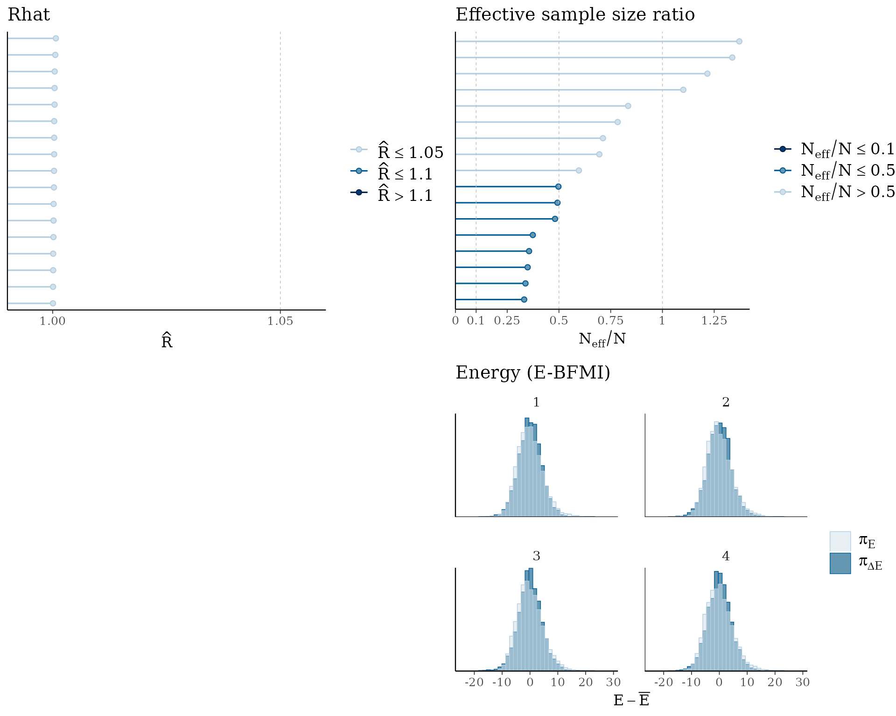
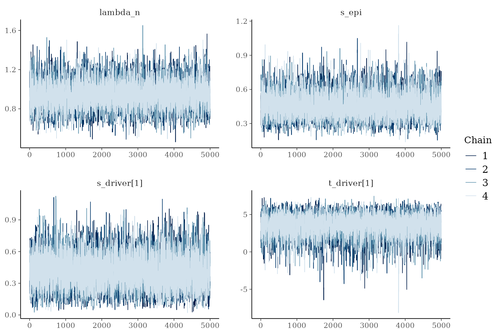
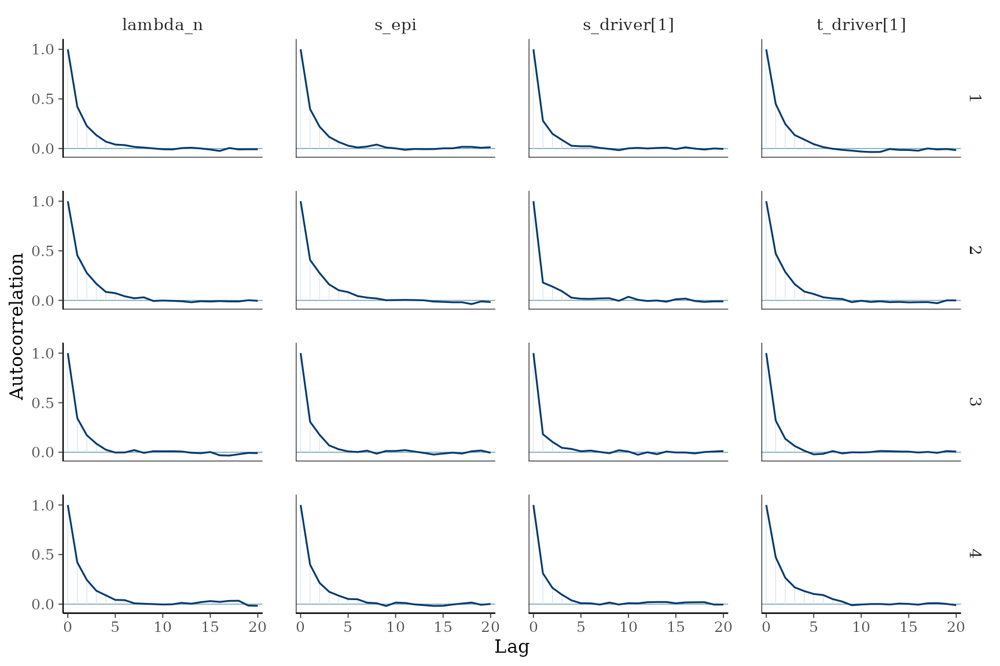
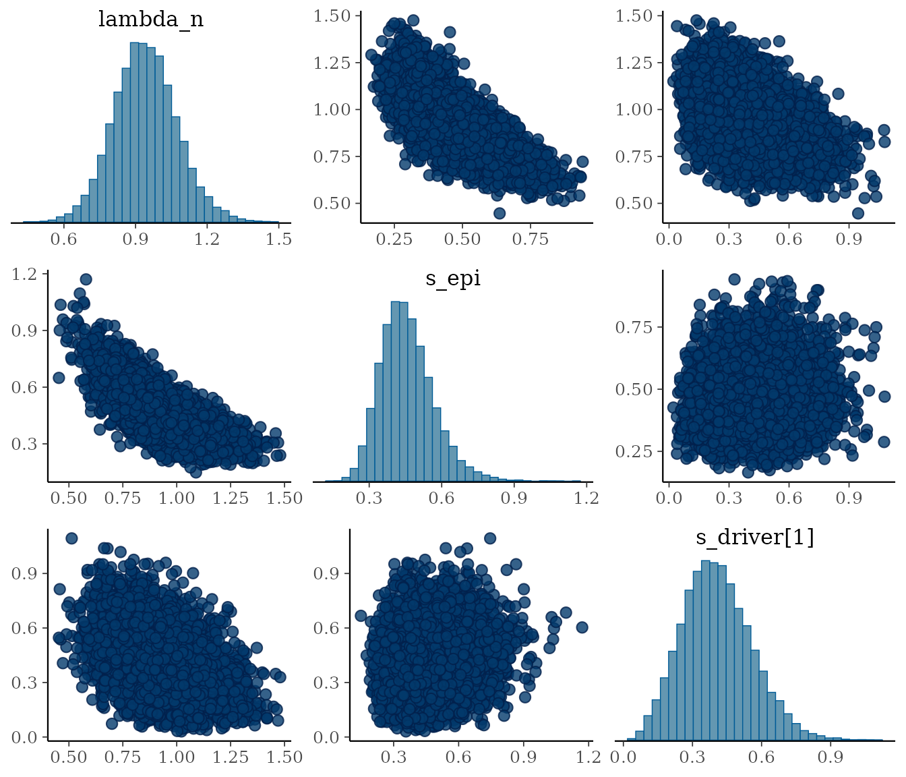
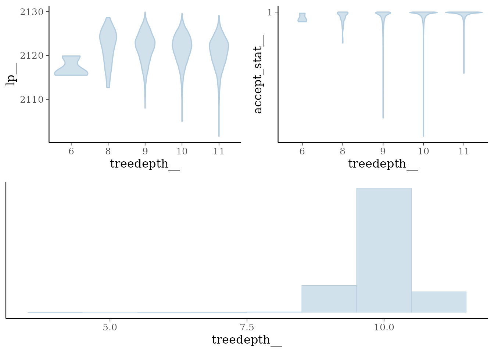

# Convergence diagnostics

``` r

library(PEPI)
library(cmdstanr)
#> This is cmdstanr version 0.8.0
#> - CmdStanR documentation and vignettes: mc-stan.org/cmdstanr
#> - CmdStan path: /home/runner/.cmdstan/cmdstan-2.35.0
#> - CmdStan version: 2.35.0
#> 
#> A newer version of CmdStan is available. See ?install_cmdstan() to install it.
#> To disable this check set option or environment variable cmdstanr_no_ver_check=TRUE.
library(bayesplot)
#> This is bayesplot version 1.16.0
#> - Online documentation and vignettes at mc-stan.org/bayesplot
#> - bayesplot theme set to bayesplot::theme_default()
#>    * Does _not_ affect other ggplot2 plots
#>    * See ?bayesplot_theme_set for details on theme setting
library(dplyr)
#> 
#> Attaching package: 'dplyr'
#> The following objects are masked from 'package:stats':
#> 
#>     filter, lag
#> The following objects are masked from 'package:base':
#> 
#>     intersect, setdiff, setequal, union
```

[`fit_multirates()`](https://caravagnalab.github.io/PEPI/reference/fit_multirates.md)
samples the posterior with Hamiltonian Monte Carlo (NUTS). Before
trusting a result, check that the chains actually converged. The
diagnostics below are thin wrappers around
[bayesplot](https://mc-stan.org/bayesplot/), which already knows how to
read a `cmdstanr` fit directly, so there is no PEPI-specific plotting
logic to learn.

## The fit

We use the fit of `vignette("Multirates_inference")`: the same data,
priors and sampler settings (4 chains, 1000 warmup and 5000 sampling
iterations, `adapt_delta = 0.99`, `max_treedepth = 15`). The code is
hidden here; see that article for the details.

``` r

x = fit_multirates(
  x,
  seed = 31,
  chains = 4,
  parallel_chains = 4,
  ndraws = 5000,
  adapt_delta = 0.99,
  max_treedepth = 15,
  init = rep(list(list(omega_p_wt = 3e-3, omega_p_driver = 3e-3)), 4),
  mu = mu$mean,
  l = 51e06,
  t_min = -20,
  ms_epi = -0.8,
  sigma_epi = 0.9,
  alpha_lambda = 10,
  beta_lambda = 10,
  alpha_n_wt = 1,
  beta_n_wt = 1e4,
  alpha_p_wt = 0.2,
  beta_p_wt = 10,
  min_kappa = 3000,
  max_kappa = 5000,
  min_sigma_count = 0.05,
  max_sigma_count = 0.15,
  include_poisson = 1,
  include_trunk = 0
)
```

## One-call dashboard

[`plot_diagnostics()`](https://caravagnalab.github.io/PEPI/reference/plot_diagnostics.md)
arranges the four checks you should look at first - R-hat, effective
sample size, divergences and the HMC energy diagnostic - into a single
figure.

``` r

plot_diagnostics(x)
#> `stat_bin()` using `bins = 30`. Pick better value `binwidth`.
#> `stat_bin()` using `bins = 30`. Pick better value `binwidth`.
```



- **R-hat** (top left): the potential scale reduction factor, one point
  per parameter. Values close to 1 mean the chains agree with each
  other; anything above about 1.05 means they haven’t converged to the
  same distribution and you need more iterations (or the model is
  misspecified).
- **Effective sample size ratio** (top right): $`N_{eff}/N`$, one point
  per parameter. Low ratios mean the chain is highly autocorrelated -
  the raw draws contain less independent information than their count
  suggests.
- **Divergences** (bottom left): transitions the sampler had to abandon
  because the numerical integrator became unstable. Even a handful can
  bias posterior estimates in the region where they occur.
- **Energy / E-BFMI** (bottom right): the marginal energy distribution
  ($`\pi_E`$) should closely track the energy transition distribution
  ($`\pi_{\Delta E}`$); a systematic mismatch signals inefficient
  exploration.

## Digging deeper into individual diagnostics

Each panel above is also available on its own, and accepts a `params`
argument (Stan parameter base names, no brackets - indexed parameters
like `s_driver` are expanded to all of their elements automatically) to
zoom in on a specific subset.

``` r

plot_trace(x, params = c("lambda_n", "s_epi", "s_driver", "t_driver"))
#> No divergences to plot.
```



Trace plots overlay each chain’s path through the parameter space over
iterations; well-mixed chains look like “fuzzy caterpillars” with no
trend and substantial overlap between chains.

``` r

plot_acf(x, params = c("lambda_n", "s_epi", "s_driver", "t_driver"))
```



Autocorrelation should decay quickly with lag; slow decay is the same
problem the effective-sample-size panel flags, just visualised directly.

``` r

plot_pairs(x, params = c("lambda_n", "s_epi", "s_driver"))
```



Pairs plots are the standard way to spot the funnel-shaped geometries
that cause divergences (marked in red, if any) - a divergence cluster
concentrated in a narrow region of this plot points at exactly which
parameters are hard to sample jointly.

``` r

plot_treedepth(x)
```



Chains that repeatedly hit the maximum treedepth are being cut off
before making a U-turn; this hurts sampling efficiency (though, unlike
divergences, it does not necessarily bias the posterior).

## What to do if something looks wrong

- **High R-hat / low ESS**: run more iterations (`ndraws`), or more
  chains (`chains`) so R-hat has more information to detect
  disagreement.
- **Divergences**: tighten the priors that are letting the sampler
  explore an implausible, poorly-conditioned region (e.g. narrow
  `min_kappa`/ `max_kappa`, `min_sigma_count`/`max_sigma_count` bounds,
  or gamma priors on the switch rates `omega_*` closer to the scale you
  actually expect).
- **Both persist**: check that the priors are consistent with the data
  (see the prior vs posterior plots of
  `vignette("Multirates_inference")`), and consider increasing
  `adapt_delta` or `max_treedepth`.
