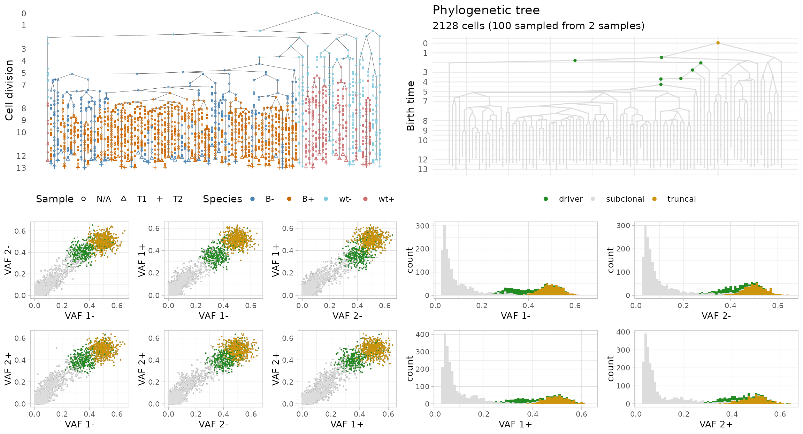
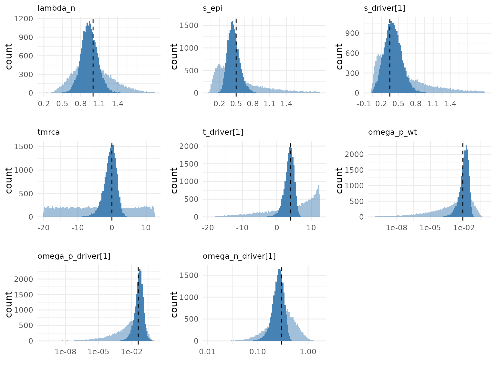
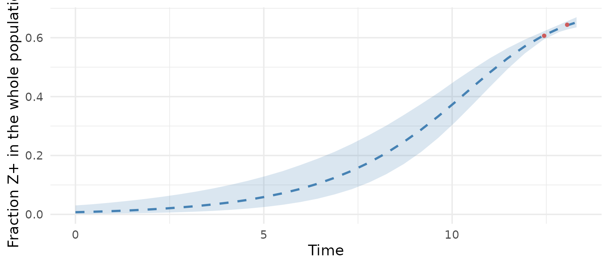
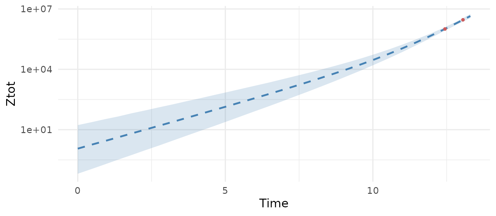
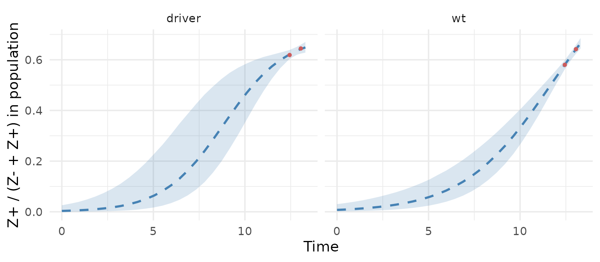
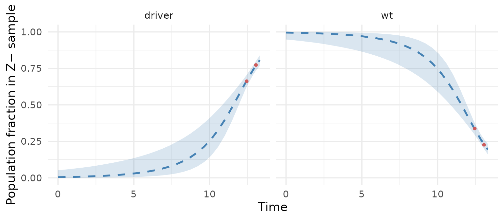
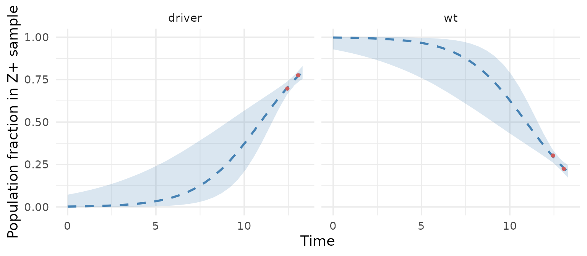

# Inference

``` r

library(PEPI)
library(dplyr)
```

We fit PEPI on the polyclonal dataset generated in
`vignette("Data_generation")` and shipped with the package: a wild-type
population switching between the “-” and “+” epistates, in which a
driver (mutant `B`) is acquired by a “-” cell. Cells are sorted by
epistate and sequenced at two time points, and the population is counted
at the same times.

The parameters used to simulate the data are:

``` r

truth = c(
  "lambda_n" = 1,
  "s_epi" = 0.5,
  "s_driver[1]" = 0.35,
  "omega_p_wt" = 8e-3,
  "tmrca" = 0,
  "t_driver[1]" = 4,
  "omega_p_driver[1]" = 4e-2,
  "omega_n_driver[1]" = 0.3
)
```

## The data

``` r

data("forest")
data("muts")
```

The phylogenetic forest of the sampled cells, restricted to the branches
of 50 random cells per sample, coloured by species (left), and with the
driver branch and the truncal node highlighted (right). Below, the
pairwise and marginal VAF spectra of the four sorted samples, with the
same labels.

``` r

PEPI:::plot_data(forest, muts, seed = 31)
```



## From the data to the model input

The model input is built from the population sizes of the “-” and “+”
compartments at the two sampling times, the number of mutations on the
driver branch, and the CCF of the driver in the four sorted samples.
Population sizes and mutation counts are perturbed with measurement
noise.

``` r

data("counts")
data("muts")
data("forest")
data("mu")

# The two sampling times.
sampling_times = c(
  counts$sampling_time_1 %>% unique(),
  counts$sampling_time_2 %>% unique()
)
t1 = sampling_times[1]
t2 = sampling_times[2]

# Fraction of "-" and "+" cells in the two samples.
ccf = forest %>% filter(!is.na(sample)) %>% group_by(epistate, sample) %>%
  summarize(n = length(cell_id)) %>% group_by(sample) %>% mutate(n = n/sum(n))

# Total population size at the two sampling times...
z1 = counts %>% filter(time == t1) %>%
  group_by(epistate, mutant) %>% summarize(count = max(count)) %>%
  pull(count) %>% unique() %>% sum()

z2 = counts %>% filter(time == t2) %>%
  group_by(epistate, mutant) %>% summarize(count = max(count)) %>%
  pull(count) %>% unique() %>% sum()

set.seed(31)

# ... measured with lognormal noise.
z1 = exp(rnorm(n = 1, mean = log(z1), sd = 0.2))
z2 = exp(rnorm(n = 1, mean = log(z2), sd = 0.2))

zminus = c(z1, z2) * (ccf %>% filter(epistate == "-") %>% pull(n))
zplus = c(z1, z2) * (ccf %>% filter(epistate == "+") %>% pull(n))

# The driver is the first cell of mutant "B": its branch carries the
# mutations accumulated from the root to the driver acquisition.
driver_id = forest %>% filter(mutant == "B") %>% pull(cell_id) %>% min()
driver_branch = PEPI:::get_branch(forest, cell_id = driver_id, stop_id = 0)

m_driver = muts %>% filter(first_cell_id %in% driver_branch) %>% nrow()
m_driver = rnbinom(n = 1, mu = m_driver, size = 100)

# Driver CCF in the four sorted samples, from the VAF of the driver
# mutations (VAF 1-, VAF 1+, VAF 2-, VAF 2+).
ccf_dr = 2 * (muts %>% filter(first_cell_id %in% driver_id) %>%
  dplyr::select(Sampling_1_N.VAF, Sampling_1_P.VAF,
                Sampling_2_N.VAF, Sampling_2_P.VAF) %>%
  reshape2::melt(id.vars = NULL) %>%
  group_by(variable) %>% summarize(v = mean(value)) %>% pull(v))
```

The prior on the driver “+” → “-” switch rate is derived from the data:

``` r

# Gamma prior on the "+" -> "-" switch rate of the driver, from a plausible
# range of values. The growth rate is bounded above by the growth of the
# total population (log-linear fit of noisy counts above 1e5 cells) and below
# by the growth of the driver "+" cells between the two samples.
z = counts %>% group_by(time) %>% summarize(tot = sum(count)) %>%
  filter(tot > 1e5)

z$tot = exp(rnorm(n = length(z$tot), mean = log(z$tot), sd = 0.2))

fit = lm(log(tot) ~ time, data = z)

lambda_max = coef(fit)[["time"]]
lambda_min = log((zplus[2] * ccf_dr[4]) / (zplus[1] * ccf_dr[2])) / ((1 + 2) * (t2 - t1))

s_max = 2
s_min = 0.1

# ratio of driver "-" and "+" cells at the second sample
rho = (zminus[2] * ccf_dr[3]) / (zplus[2] * ccf_dr[4])

omega_max = rho * lambda_min * s_max
omega_min = rho * lambda_max * s_min

omega_gamma = PEPI:::fit_gamma_quantiles(omega_min, omega_max, p1 = 0.05, p2 = 0.95)
```

``` r

omega_gamma
#> $shape
#> [1] 2.950961
#> 
#> $rate
#> [1] 8.491413
```

The tables required by
[`init_multirates()`](https://caravagnalab.github.io/PEPI/reference/init_multirates.md):

``` r

tables = list(

  population_sizes = tibble(
    time = sampling_times,
    type = "sampling",
    zminus = zminus,
    zplus = zplus
  ),

  # the wild type is the complement of the driver
  wt_ccf = tibble(
    time = rep(sampling_times, each = 2),
    epistate = rep(c("-", "+"), 2),
    ccf = 1 - ccf_dr
  ),

  driver_muts = tibble(
    driver_id = "B",
    m_driver = m_driver,
    ms_driver = -0.8,
    sigma_driver = 0.9,
    alpha_n_driver = omega_gamma$shape,
    beta_n_driver = omega_gamma$rate,
    alpha_p_driver = 0.3,
    beta_p_driver = 6
  ),

  driver_ccf = tibble(
    driver_id = "B",
    time = rep(sampling_times, each = 2),
    epistate = rep(c("-", "+"), 2),
    ccf = ccf_dr
  )
)

x = init_multirates(tables, m_trunk = 0)
```

``` r

tables
#> $population_sizes
#> # A tibble: 2 × 4
#>    time type       zminus    zplus
#>   <dbl> <chr>       <dbl>    <dbl>
#> 1  12.4 sampling  397730.  613447.
#> 2  13.1 sampling 1030393. 1863969.
#> 
#> $wt_ccf
#> # A tibble: 4 × 3
#>    time epistate   ccf
#>   <dbl> <chr>    <dbl>
#> 1  12.4 -        0.338
#> 2  12.4 +        0.303
#> 3  13.1 -        0.227
#> 4  13.1 +        0.225
#> 
#> $driver_muts
#> # A tibble: 1 × 8
#>   driver_id m_driver ms_driver sigma_driver alpha_n_driver beta_n_driver
#>   <chr>        <dbl>     <dbl>        <dbl>          <dbl>         <dbl>
#> 1 B              424      -0.8          0.9           2.95          8.49
#> # ℹ 2 more variables: alpha_p_driver <dbl>, beta_p_driver <dbl>
#> 
#> $driver_ccf
#> # A tibble: 4 × 4
#>   driver_id  time epistate   ccf
#>   <chr>     <dbl> <chr>    <dbl>
#> 1 B          12.4 -        0.662
#> 2 B          12.4 +        0.697
#> 3 B          13.1 -        0.773
#> 4 B          13.1 +        0.775
```

## Inference

[`fit_multirates()`](https://caravagnalab.github.io/PEPI/reference/fit_multirates.md)
samples the posterior with Hamiltonian Monte Carlo (NUTS) via cmdstanr:
here 4 chains with 1000 warmup and 5000 sampling iterations each.
Convergence is assessed in `vignette("Convergence_diagnostics")`.

``` r

x = fit_multirates(
  x,
  seed = 31,
  chains = 4,
  parallel_chains = 4,
  ndraws = 5000,
  adapt_delta = 0.99,
  max_treedepth = 15,
  init = rep(list(list(omega_p_wt = 3e-3, omega_p_driver = 3e-3)), 4),
  mu = mu$mean,
  l = 51e06,
  t_min = -20,
  ms_epi = -0.8,
  sigma_epi = 0.9,
  alpha_lambda = 10,
  beta_lambda = 10,
  alpha_n_wt = 1,
  beta_n_wt = 1e4,
  alpha_p_wt = 0.2,
  beta_p_wt = 10,
  min_kappa = 3000,
  max_kappa = 5000,
  min_sigma_count = 0.05,
  max_sigma_count = 0.15,
  include_poisson = 1,
  include_trunk = 0
)
```

Posterior summary, next to the values used to simulate the data:

``` r

x$inference$multirates$summary(variables = names(truth)) %>%
  mutate(truth = truth[variable]) %>%
  dplyr::select(variable, truth, mean, median, sd, q5, q95, rhat, ess_bulk)
#> # A tibble: 8 × 9
#>   variable          truth    mean  median     sd       q5    q95  rhat ess_bulk
#>   <chr>             <dbl>   <dbl>   <dbl>  <dbl>    <dbl>  <dbl> <dbl>    <dbl>
#> 1 lambda_n          1      0.942   0.938  0.133   0.728   1.17   1.00     6660.
#> 2 s_epi             0.5    0.457   0.446  0.109   0.300   0.652  1.00     7056.
#> 3 s_driver[1]       0.35   0.407   0.398  0.151   0.173   0.671  1.00     8898.
#> 4 omega_p_wt        0.008  0.0147  0.0123 0.0110  0.00172 0.0362 1.000    7088.
#> 5 tmrca             0     -0.538  -0.303  1.94   -4.01    2.15   1.00     6976.
#> 6 t_driver[1]       4      3.57    3.75   1.43    0.986   5.54   1.00     7159.
#> 7 omega_p_driver[1] 0.04   0.0651  0.0506 0.0582  0.00819 0.170  1.000    9047.
#> 8 omega_n_driver[1] 0.3    0.259   0.259  0.0646  0.154   0.367  1.00     9078.
```

## Prior vs posterior

Prior (transparent) and posterior (solid) distributions; dashed lines
mark the values used to simulate the data.

``` r

x = get_posterior_multirates(x)

plot_prior_posterior(x, params = names(truth), truth = truth)
```



## Posterior predictive checks

[`get_predicted_trajectories()`](https://caravagnalab.github.io/PEPI/reference/get_predicted_trajectories.md)
simulates new data from the posterior along a time grid. For every draw,
the latent “-” and “+” sizes of each population are computed from the
model; each population then gets a lognormal total count and a beta
“+”/“-” split, as in the likelihood, and CCFs are evaluated on the
sampled counts within the “-” and “+” samples. Observed data are shown
in red.

``` r

pred = get_predicted_trajectories(x)
```

Fraction of “+” cells in the whole population and total population size:

``` r

plot_fractions(x, pred)
```



``` r

plot_counts(x, pred)
```



Two different fractions describe each population $`k`$ (wild type,
driver). The first is the fraction of its cells in the “+” state,
$`Z^+_k / (Z^-_k + Z^+_k)`$: how the population itself is split between
the two epistates.

``` r

plot_split(x, pred)
```



The second is the fraction of each sorted sample made of the population,
i.e. its CCF in that sample: $`Z^-_k / \sum_j Z^-_j`$ in the “-” sample
and $`Z^+_k / \sum_j Z^+_j`$ in the “+” sample. In each sample these
fractions sum to 1 over the populations.

``` r

plot_ccf(x, epistate = "-", pred = pred)
```



``` r

plot_ccf(x, epistate = "+", pred = pred)
```


